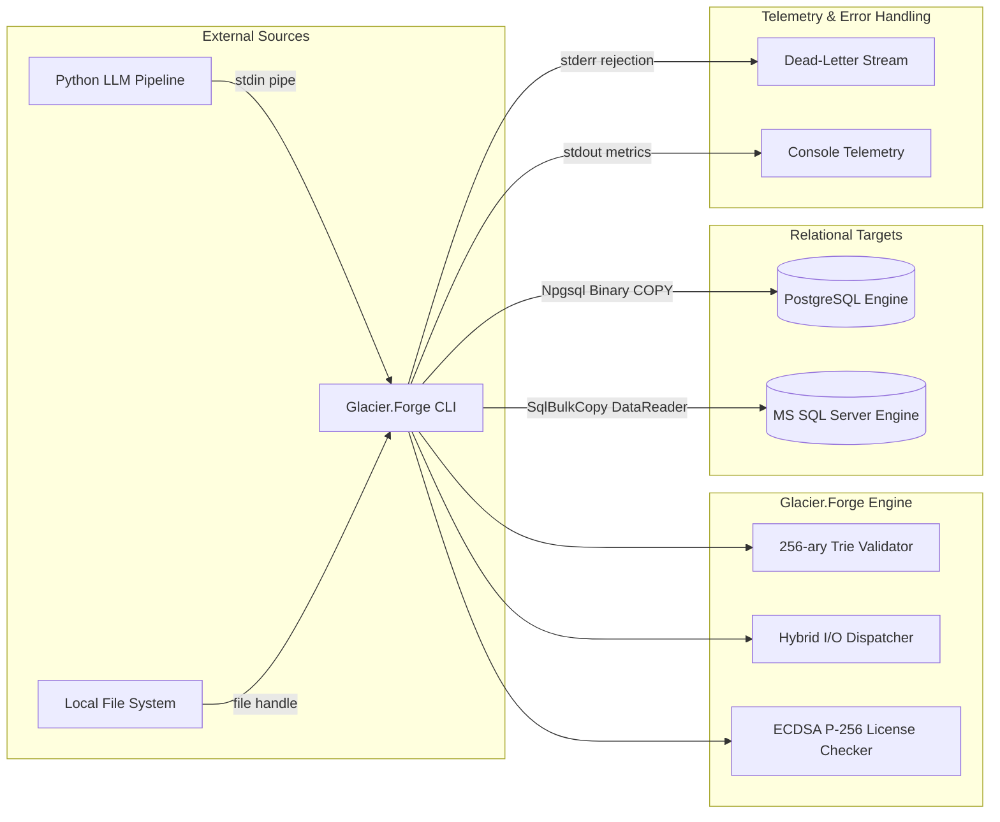
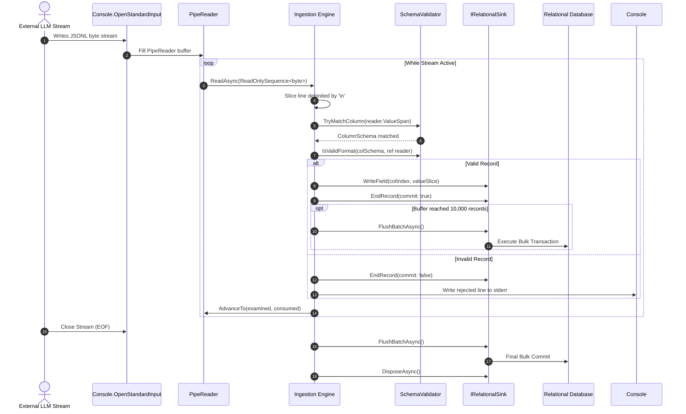
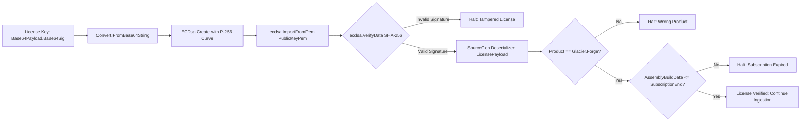

# Architecture Specification: Glacier.Forge

**System Name**: Glacier.Forge — High-Performance Semantic-to-Relational Hardener  
**Standard Compliance**: Arc42 (v8.2) Architecture Documentation Framework  
**Linguistic Standard**: ASD-STE100 Simplified Technical English  
**Runtime Target**: .NET 10.0 (C# 13, Native AOT Compatible)  
**Document Revision**: 2.0.0  

---

## 1. Introduction and Goals

Glacier.Forge is an ingestion engine built for high-throughput streaming environments. The system ingests non-deterministic, semantic JSONL records emitted by Large Language Model (LLM) inference pipelines. It validates each record against a strict database schema and bulk-loads the validated records directly into relational database engines (PostgreSQL and Microsoft SQL Server).

Traditional ingestion tools deserialize JSON payloads into managed heap objects. This practice creates massive Garbage Collector (GC) heap pressure, triggers stop-the-world GC pauses, and degrades real-time streaming throughput. Glacier.Forge eliminates this bottleneck by executing all stream slicing, schema matching, and format validation in raw UTF-8 byte space.

### 1.1 Requirements Overview

| Identifier | Requirement Statement | Operational Verification |
| :--- | :--- | :--- |
| **REQ-01** | Process continuous streaming records from `stdin` and local files. | Verified via `PipeReader` streaming and `HybridIoDispatcher`. |
| **REQ-02** | Validate column names and data types against relational database catalogs. | Verified via dynamic catalog queries (`sys.columns`, `information_schema`). |
| **REQ-03** | Execute stream processing with 0 bytes of managed heap allocations on the hot path. | Verified via BenchmarkDotNet diagnosers (`Allocated Memory = 0 B`). |
| **REQ-04** | Stream batches directly into PostgreSQL using binary wire formats. | Verified via `NpgsqlBinaryImporter` and `COPY BINARY` protocol. |
| **REQ-05** | Stream batches directly into Microsoft SQL Server without intermediate string allocations. | Verified via `PooledBatchDataReader` and `SqlBulkCopy`. |
| **REQ-06** | Support compilation into a standalone, trim-safe Native AOT executable binary. | Verified via `PublishAot=true` and source-generated JSON contexts. |

### 1.2 Quality Goals (ISO/IEC 25010)

1. **Performance Efficiency**: Sustain an ingestion throughput exceeding 5,000,000 records per second in memory, with exactly 0 bytes of Gen 0/1/2 managed heap allocations on the hot parsing path.
2. **Reliability & Data Integrity**: Prevent partial or corrupted record commits. Reject malformed records cleanly to a dead-letter output stream (`stderr`) without terminating the ingestion daemon.
3. **Low Latency**: Ensure single-batch commit latency remains under 500 microseconds for 1,000 records, completely avoiding GC pause interference.
4. **Interoperability**: Connect natively to standard production deployments of Microsoft SQL Server (2016+) and PostgreSQL (12+).

### 1.3 Stakeholders

- **Data Platform Engineers**: Deploy and integrate high-velocity data ingestion pipelines.
- **AI Systems Architects**: Connect local LLM token streams to durable enterprise relational storage.
- **Database Administrators (DBAs)**: Require strict type safety, zero database connection hogging, and efficient bulk transaction commits.

---

## 2. Architecture Constraints

The following hard technical constraints govern the implementation of Glacier.Forge:

```text
┌─────────────────────────────────────────────────────────────────────────────┐
│                      MANDATORY ARCHITECTURE CONSTRAINTS                     │
├────────────────────────────────┬────────────────────────────────────────────┤
│ Constraint                     │ Enforcement Mechanism                      │
├────────────────────────────────┼────────────────────────────────────────────┤
│ Zero Object-Relational Mappers │ EF Core, Dapper, and LINQ-to-DB forbidden. │
│ Zero Managed Heap Churn        │ No string.Split, Substring, or new byte[]. │
│ Low-Level Memory Primitives    │ ReadOnlySpan<byte>, ArrayPool, MMF only.   │
│ Pure Native ADO.NET Drivers    │ Microsoft.Data.SqlClient and Npgsql only.  │
│ Native AOT Compilation Safety  │ No runtime reflection. Source gen JSON.    │
└────────────────────────────────┴────────────────────────────────────────────┘
```

1. **No Object-Relational Mappers (ORMs)**: Entity Framework Core, Dapper, and similar high-level abstraction frameworks are strictly prohibited. The system interacts with database engines exclusively through native low-level ADO.NET providers (`Microsoft.Data.SqlClient` and `Npgsql`).
2. **Zero-Allocation Hot Path**: The hot data path—reading tokens, parsing strings, validating data types, and staging database records—must not allocate managed heap objects. The Garbage Collector must remain idle during ingestion loops.
3. **Memory Primitive Usage**: All byte and character processing must use low-level memory primitives: `ReadOnlySpan<byte>`, `Span<byte>`, `ReadOnlySequence<byte>`, `Memory<T>`, `ArrayPool<T>`, and `ref struct` types.
4. **Native AOT Compatibility**: The codebase must support ahead-of-time native compilation (`PublishAot=true`). Dynamic code generation, runtime reflection emit, and unannotated reflection calls are prohibited.
5. **No Third-Party Bloat**: Third-party mapping libraries (such as AutoMapper) and external dependency injection containers are forbidden. The engine maintains a minimal dependency graph consisting solely of standard runtime libraries and official database drivers.

---

## 3. System Scope and Context

Glacier.Forge operates as a high-speed boundary bridge between unstructured text generators and strictly structured relational storage engines.

### 3.1 Business Context

Large Language Models generate token sequences asynchronously. When an LLM produces structured data (JSONL), the output stream can contain schema drift, extra keys, missing fields, or malformed values. Glacier.Forge intercepts these non-deterministic streams, validates every attribute against a verified relational catalog, and safely inserts valid records into enterprise tables while routing invalid lines to a dead-letter log.

```text
 ┌─────────────────┐       Raw JSONL Stream       ┌───────────────────┐     Binary Bulk Sinks     ┌───────────────────┐
 │ LLM Inference   │ ───────────────────────────► │   Glacier.Forge   │ ────────────────────────► │ Relational DB     │
 │ Engine / Script │   (stdin / Named Pipes)      │ Ingestion Hardener│   (COPY / SqlBulkCopy)    │ (Postgres/SQLSvr) │
 └─────────────────┘                              └─────────┬─────────┘                           └───────────────────┘
                                                            │ Rejected Records
                                                            ▼ (stderr)
                                                  ┌───────────────────┐
                                                  │ Dead-Letter Queue │
                                                  │ (Audit Log File)  │
                                                  └───────────────────┘
```

### 3.2 Technical Context



---

## 4. Solution Strategy

To achieve zero managed heap allocation and maximum streaming throughput, Glacier.Forge adopts four core design strategies:

1. **Zero-Transcoding UTF-8 Tokenization**: Incoming bytes remain in UTF-8 format throughout the pipeline. The parser invokes `System.Text.Json.Utf8JsonReader` over raw `ReadOnlySpan<byte>` buffers, completely avoiding transcoding into C# UTF-16 strings.
2. **256-ary Trie State Machine**: Schema column lookups execute in $O(L)$ time (where $L$ is the byte length of the column name). Case insensitivity is handled by an inlined ASCII bit-shift function (`byte - 32`), eliminating string allocation and dictionary lookups.
3. **Zero-Copy Hybrid I/O Dispatching**: Files under 1 MB are ingested via `ArrayPool<byte>` buffers and OS-level `RandomAccess.Read`. Files equal to or larger than 1 MB are mapped directly into virtual address space via `MemoryMappedFile` view accessors, allowing zero-copy span access across multi-gigabyte datasets.
4. **Direct Binary Bulk Sinks**: Data records stream into PostgreSQL via `NpgsqlBinaryImporter` using `COPY BINARY` over contiguous byte buffers. Records stream into SQL Server via `PooledBatchDataReader` using `SqlChars` pointers feeding `SqlBulkCopy`.

---

## 5. Building Block View

The system follows a modular, low-coupling architecture partitioned into distinct zero-allocation components:

```text
Glacier.Forge
├── Ingestion Engine (Program.cs)
│   ├── PipeReader Stdin Streaming Loop
│   └── Hybrid File Ingestion Loop
├── Schema & Format Validation (SchemaValidator.cs)
│   ├── 256-ary Trie Node Tree
│   ├── Inlined ASCII Case Normalizer
│   └── Utf8Parser Primitive Coercion
├── I/O Dispatcher (HybridIoDispatcher.cs)
│   ├── Pooled Array RandomAccess Reader
│   └── Memory-Mapped File Chunking Reader
├── Relational Bulk Sinks (IRelationalSink.cs)
│   ├── SqlServerSink.cs (PooledBatchDataReader + SqlBulkCopy)
│   └── PostgresSink.cs (NpgsqlBinaryImporter COPY BINARY)
└── Security & Licensing (LicenseManager.cs)
    ├── ECDSA P-256 Public Key Verifier
    └── Source-Generated AOT Deserializer
```

### 5.1 Level 1 Whitebox: Component Responsibilities

#### Ingestion Engine (`Program.cs`)
- Coordinates the application lifecycle, CLI parsing, catalog discovery, and stream loops.
- Reads streaming input from `Console.OpenStandardInput()` using `System.IO.Pipelines.PipeReader`.
- Dispatches records in line-delimited boundaries to the record parser.
- Enforces batch commit thresholds (flushing every 10,000 records or upon stream EOF).

#### Schema Validator (`SchemaValidator.cs`)
- Constructs an in-memory 256-ary Trie representing the target database schema and custom aliases.
- Matches property byte spans to column schemas in $O(L)$ time without heap allocations.
- Coerces and validates primitive formats (`int`, `guid`, `datetime`, `bool`, `float`, `decimal`) using `Utf8Parser.TryParse`.

#### Hybrid I/O Dispatcher (`HybridIoDispatcher.cs`)
- Inspects input file size to select optimal kernel read mechanisms.
- Uses `ArrayPool<byte>.Shared` and `RandomAccess.Read` with `FileOptions.SequentialScan` for files $< 1\text{ MB}$.
- Uses `MemoryMappedFile.CreateFromFile` and unsafe pointers (`byte*`) for files $\ge 1\text{ MB}$.
- Partitions files exceeding 2 GB into 1 GB contiguous chunks with backward newline scanning.

#### Relational Sinks (`SqlServerSink.cs` & `PostgresSink.cs`)
- Implements the common `IRelationalSink` contract.
- Buffers rows into pre-allocated contiguous arrays, tracking null indicators and byte slice offsets.
- Flushes accumulated batches directly to database storage using optimized bulk protocol interfaces.

#### Cryptographic License Manager (`LicenseManager.cs`)
- Validates enterprise software licenses via ECDSA P-256 and SHA-256 digital signatures.
- Implements Native AOT source-generated deserialization (`LicenseJsonContext`).
- Enforces perpetual license compliance by comparing the assembly build timestamp against subscription dates.

### 5.2 Level 2 Whitebox: Core Data Structures

#### 256-ary Trie Node Layout
```csharp
private class TrieNode
{
    // Direct byte lookup table: 256 pointers (2048 bytes on 64-bit systems)
    public readonly TrieNode?[] Children = new TrieNode?[256];
    public ColumnSchema? Schema;
}
```

Every node in the Trie allocates an array of 256 references. As byte values (0–255) arrive from the UTF-8 token stream, traversal proceeds via direct array indexing `node.Children[upperByte]`. This design eliminates hashing overhead and guarantees constant-time state transitions per byte.

#### PooledBatchDataReader Column Buffer Model
```text
  PooledBatchDataReader Buffer Topology (MaxBatchSize = 10,000)
  ┌────────────────────────────────────────────────────────────────────────┐
  │ Column 0 (int):       [ int[10000]                                   ] │
  │ Column 1 (Guid):      [ Guid[10000]                                  ] │
  │ Column 2 (DateTime):  [ DateTime[10000]                              ] │
  │ Column 3 (Text):      [ Raw Batch Buffer (10000 * 512 bytes UTF-8)   ] │
  │                       [ Offsets: int[10000] | Lengths: int[10000]    ] │
  │ Null Indicators:      [ bool[Columns][10000]                         ] │
  └────────────────────────────────────────────────────────────────────────┘
```

---

## 6. Runtime View

### 6.1 Scenario 1: Standard Input (`stdin`) Ingestion Loop



### 6.2 Scenario 2: Large File Memory-Mapped I/O (> 2 GB)

When ingesting a local file larger than 2 GB, the 32-bit index limit of `ReadOnlySpan<byte>` (`int.MaxValue`) requires intelligent chunking:

1. The dispatcher acquires a raw unmanaged memory pointer (`byte* start`) to the file view accessor.
2. The engine segments the memory space into 1 GB candidate chunks (`maxSpanChunk = 1,073,741,824`).
3. If the candidate boundary falls in the middle of a JSON record, the dispatcher scans backwards byte-by-byte until it finds a newline character (`\n`).
4. The verified line-aligned slice is dispatched to the record parser as a contiguous `ReadOnlySpan<byte>`.
5. The memory pointer advances by the validated chunk length, and the loop repeats until all bytes are processed.

---

## 7. Deployment View

Glacier.Forge compiles into a self-contained, standalone native binary using .NET 10 Native AOT. It requires no installed .NET runtime on the host environment.

```text
 ┌────────────────────────────────────────────────────────────────────────────┐
 │                       PRODUCTION DEPLOYMENT TOPOLOGY                       │
 ├────────────────────────────────────────────────────────────────────────────┤
 │                                                                            │
 │  Kubernetes Pod / Container Host                                           │
 │  ┌──────────────────────────────────────────────────────────────────────┐  │
 │  │ Container A: Local LLM Model Server (e.g. Glacier.Inference)         │  │
 │  │ Output Stream: /tmp/inference_stream.fifo (Linux Named Pipe)         │  │
 │  └──────────────────────────────────┬───────────────────────────────────┘  │
 │                                     │ streaming JSONL                      │
 │                                     ▼                                      │
 │  ┌──────────────────────────────────────────────────────────────────────┐  │
 │  │ Container B: Glacier.Forge Ingestion Sidecar                         │  │
 │  │ Command: Glacier.Forge --db postgres --table events < /tmp/fifo      │  │
 │  │ Memory Working Set: < 64 MB RSS (Zero Heap Allocation)               │  │
 │  └──────────────────────────────────┬───────────────────────────────────┘  │
 │                                     │ High-Speed TCP / Binary COPY         │
 │                                     ▼                                      │
 │  ┌──────────────────────────────────────────────────────────────────────┐  │
 │  │ Database Server: PostgreSQL 16 Cluster / AWS Aurora                   │  │
 │  └──────────────────────────────────────────────────────────────────────┘  │
 └────────────────────────────────────────────────────────────────────────────┘
```

### Deployment Configuration Options

- **Environment Variables**:
  - `ConnectionStrings__SqlServer`: Connection string for SQL Server targets.
  - `ConnectionStrings__Postgres`: Connection string for PostgreSQL targets.
  - `GLACIER_LICENSE`: Cryptographic enterprise license key string.
- **Local Secret Store**:
  - `dotnet user-secrets` for secure local development without credential leakage.

---

## 8. Cross-Cutting Concepts

### 8.1 Zero-Allocation Memory Primitives

The core architectural requirement is the elimination of managed heap allocations. The table below outlines how standard allocation patterns are replaced with zero-allocation primitives:

| Traditional Allocation Pattern | Glacier.Forge Zero-Allocation Primitive | Architectural Benefit |
| :--- | :--- | :--- |
| `string.Substring(start, len)` | `ReadOnlySpan<byte> slice` | Avoids character array copies; operates directly on buffer pointers. |
| `Encoding.UTF8.GetString(bytes)` | `Utf8Parser.TryParse(span, out ...)` | Parses numbers, GUIDs, and dates directly from raw UTF-8 bytes. |
| `new byte[bufferSize]` | `ArrayPool<byte>.Shared.Rent(...)` | Reuses existing heap buffers; eliminates GC collection triggers. |
| `new FileStream(path, FileMode.Open)` | `MemoryMappedFile` pointer access | Maps OS file cache pages directly into process address space. |
| Dynamic heap objects | `ref struct` and `stackalloc byte[2048]` | Allocates small working buffers directly on the execution stack. |

### 8.2 Fast ASCII Case-Insensitive State Machine

SQL databases often treat column names case-insensitively, whereas JSON keys can vary. Converting strings to uppercase via `string.ToUpperInvariant()` generates managed heap churn. Glacier.Forge implements branchless ASCII uppercase conversion directly in byte space:

```csharp
[MethodImpl(MethodImplOptions.AggressiveInlining)]
private static byte ToUpperAscii(byte b)
{
    // ASCII lowercase range: 97 ('a') through 122 ('z')
    if (b >= 97 && b <= 122)
    {
        return (byte)(b - 32); // Clears bit 5 to produce uppercase ASCII
    }
    return b;
}
```

This method executes in a single CPU instruction cycle, ensuring $O(L)$ Trie matching without heap allocations.

### 8.3 Thread-Safety and Concurrency Model

- **Instance Isolation**: `SchemaValidator`, `TrieNode`, and relational sink instances are strictly single-threaded per stream. Parallel ingestion pipelines instantiate independent `IRelationalSink` and `SchemaValidator` instances per thread to avoid synchronization locks.
- **Lock-Free Read Operations**: The Trie structure is populated once during catalog initialization and remains immutable during stream processing. It supports concurrent read operations across multiple threads without locking.
- **Pooled Buffer Ownership**: Rented `ArrayPool` buffers must be returned in `finally` blocks to prevent buffer pool exhaustion.

### 8.4 Cryptographic Licensing Architecture

Glacier.Forge includes an enterprise compliance verification mechanism based on asymmetric cryptography:



- **Algorithm**: Elliptic Curve Digital Signature Algorithm (ECDSA) with NIST P-256 curve and SHA-256 digest.
- **Signature Format**: `DSASignatureFormat.IeeeP1363FixedFieldConcatenation` (raw $R \parallel S$ 64-byte binary signature).
- **Perpetual Fallback Rule**: Perpetual licenses never expire for versions compiled before the subscription end date. The assembly build date is extracted from `AssemblyInformationalVersionAttribute` and evaluated against `payload.SubscriptionEnd`.

### 8.5 Error Recovery and Dead-Letter Handling

When the ingestion engine encounters a malformed JSON line, an unmappable field, or a nullability violation:
1. The active record in the sink is marked invalid via `sink.EndRecord(commit: false)`.
2. The sink resets the record's buffer offsets, discarding buffered values without flushing.
3. The raw rejected byte line is emitted directly to `Console.Error` (`stderr`).
4. Downstream operators can redirect `stderr` to a separate dead-letter queue (DLQ) file without interrupting standard input ingestion.

---

## 9. Architectural Decisions (ADR Log)

### ADR-001: 256-ary Trie vs. String Hash Table for Column Validation
- **Status**: Accepted
- **Context**: Incoming JSON property names must be validated against target table columns at multi-million row per second velocities.
- **Decision**: Adopt a 256-ary byte Trie instead of a `Dictionary<string, ColumnSchema>`.
- **Consequences**: Avoids converting UTF-8 byte spans to C# strings. Traversal requires $O(L)$ byte reads. Memory consumption is slightly higher (256 pointers per Trie node), but total columns per database table rarely exceed 500, resulting in negligible total memory usage (< 1 MB).

### ADR-002: Zero-Copy Memory-Mapped Files vs. Buffered FileStream
- **Status**: Accepted
- **Context**: Ingesting multi-gigabyte JSONL datasets using standard `FileStream` causes buffer copy overhead and GC memory allocations.
- **Decision**: Implement `HybridIoDispatcher`. Files $< 1\text{ MB}$ use `ArrayPool<byte>` with OS `RandomAccess`. Files $\ge 1\text{ MB}$ use `MemoryMappedFile` view accessors.
- **Consequences**: Enables the OS kernel to page memory directly into process address space without intermediate userspace buffer copying. Accommodates files exceeding 2 GB through line-aligned 1 GB chunking.

### ADR-003: Postgres Binary COPY Protocol vs. Text CSV COPY
- **Status**: Accepted
- **Context**: Bulk-loading data into PostgreSQL can use either text format CSV streaming or binary format `COPY ... FROM STDIN (FORMAT BINARY)`.
- **Decision**: Implement `PostgresSink` using raw binary `COPY` through `NpgsqlBinaryImporter`.
- **Consequences**: Eliminates CSV character escaping overhead and server-side text parsing. Binary integer, UUID, and date formats are transmitted directly in network byte order. Text fields are written directly as raw UTF-8 byte spans.

### ADR-004: Native AOT Source Generation vs. System.Reflection Deserialization
- **Status**: Accepted
- **Context**: Licensing and application configuration deserialization must function under Native AOT compilation.
- **Decision**: Implement `System.Text.Json.Serialization.JsonSerializerContext` source generators (`LicenseJsonContext`).
- **Consequences**: Replaces runtime reflection with compile-time code generation. Ensures zero trimming warnings, reduces binary footprint, and allows sub-10 ms cold startup times.

---

## 10. Quality Requirements

### 10.1 Quality Tree

```text
Glacier.Forge Quality Model
├── Performance Efficiency
│   ├── Hot-Path Allocations: Strictly 0 Bytes
│   ├── Parse Throughput: >= 5,000,000 records/sec
│   └── Ingestion Latency: <= 200 μs per 1,000 records
├── Reliability
│   ├── Schema Conformance: 100% strict type safety
│   ├── Transaction Atomicity: All-or-nothing batch commit
│   └── Error Containment: Malformed lines routed to stderr
└── Portability & Deployability
    ├── Native AOT: Single executable deployment
    ├── Operating Systems: Windows x64, Linux x64/arm64
    └── Target Databases: PostgreSQL 12+, MS SQL Server 2016+
```

### 10.2 Quality Scenarios

- **Scenario QS-1 (High-Velocity Streaming)**: Under a sustained input stream of 500,000 JSONL records per second from an external process, Glacier.Forge must buffer and commit records without triggering a Gen 0 Garbage Collection event.
- **Scenario QS-2 (Schema Drift Containment)**: When an LLM generates unexpected extra fields or arrays in the JSON payload, the engine must skip the superfluous structures via `reader.Skip()` in zero-allocation byte space without failing valid fields.
- **Scenario QS-3 (Network Stutter Resilience)**: If the incoming stream experiences delays or pauses, database connections must not stay open indefinitely. PostgreSQL binary `COPY` operations are opened exclusively during batch flushes.

---

## 11. Risks and Technical Debt

| Risk Description | Probability | Impact | Mitigation Strategy |
| :--- | :--- | :--- | :--- |
| **Unbounded Single-Line JSON Length**: A single JSON line exceeding 2 MB could cause stack overflow if `stackalloc` is misused. | Low | High | Lines $\le 2048$ bytes use `stackalloc`. Lines $> 2048$ bytes safely fall back to `ArrayPool<byte>.Shared.Rent`. |
| **Virtual Address Space Exhaustion**: Mapping multiple 50 GB files concurrently on 32-bit systems could fail. | Negligible | High | Glacier.Forge targets 64-bit architectures exclusively (`x64`, `arm64`). View accessors are promptly disposed in `finally` blocks. |
| **Complex Nested JSON Ingestion**: Deeply nested JSON structures sent to a relational scalar column cannot be automatically mapped. | Medium | Low | Nested objects are bypassed via `reader.Skip()`. For columns typed as `json` or `jsonb`, raw byte spans are stored directly. |

---

## 12. Glossary

- **ASD-STE100**: Simplified Technical English specification for writing clear, unambiguous technical documentation.
- **Arc42**: Comprehensive, industry-standard architecture documentation framework.
- **Byte-Space Validation**: Executing parsing, hashing, and schema validation directly on raw UTF-8 byte spans without converting to C# UTF-16 character strings.
- **Dead-Letter Queue (DLQ)**: An auxiliary output channel (`stderr`) where invalid or rejected records are written for inspection without halting the main ingestion pipeline.
- **MemoryMappedFile (MMF)**: An OS-level feature that maps file contents directly into the virtual address space of the process, enabling zero-copy pointer access.
- **Native AOT**: Ahead-of-Time compilation in .NET that compiles C# directly into machine code, eliminating the JIT compiler and runtime reflection dependencies.
- **PooledBatchDataReader**: A custom zero-allocation implementation of ADO.NET `DbDataReader` that feeds memory-buffered rows into `SqlBulkCopy`.
- **Trie**: An $N$-ary search tree data structure where each node corresponds to a character or byte, enabling $O(L)$ search complexity where $L$ is key length.
- **Utf8JsonReader**: A high-performance, low-level, forward-only tokenizer for UTF-8 encoded JSON text provided by `System.Text.Json`.
- **Zero-Allocation**: A programming paradigm ensuring that critical code paths execute with zero managed heap memory allocations, completely preventing Garbage Collection latency.