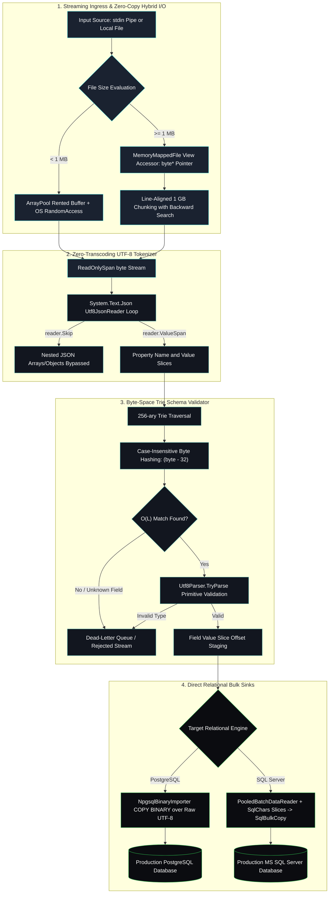

# Glacier.Forge

[](https://opensource.org/licenses/MIT)
[](https://dotnet.microsoft.com/)
[](#benchmarks-performance-summary)
[](https://glaciersoftware.dev/)
[](https://buymeacoffee.com/glaciersoftware)
[](https://ko-fi.com/glaciersoftware)
[](https://github.com/sponsors/ian-cowley)

A high-performance ingestion engine for C# .NET 10. It hardens unstructured semantic JSONL token streams into strictly typed relational database rows.

Glacier.Forge parses incoming JSON tokens in raw byte space. It validates data types against target database schemas and writes records directly into Microsoft SQL Server and PostgreSQL. The hot path maintains **zero managed heap allocations (0 B)**, which completely prevents Garbage Collector (GC) latency pauses.

**100% Free and Open-Source software under the MIT License.**

---

## Architecture Visualizations

### Layer 1: Laymen Metaphor — The High-Speed Factory Sorter & Express Train

> *Imagine a high-speed factory conveyor belt. Delivery trucks dump millions of unsorted packages onto the belt. Traditional systems open every package, translate the shipping label into local text, and carry each item by hand. This creates massive piles of wrapping trash that halt the factory floor during cleanup.*
>
> *Glacier.Forge acts as an automated laser scanner and express train. As packages zoom past at high speed, the scanner reads the barcode in raw byte space without opening the box. If the barcode matches the warehouse catalog, a robotic arm diverts the package into a freight container. When the container reaches capacity, an express train delivers all items directly into the database terminal in microseconds. Zero trash remains on the factory floor.*

```text
 Unsorted LLM Stream         Laser Scanner                Robotic Arm              Express Train Terminal
 [ {"id":1, ...} \n ] ────► [ Byte-Space Trie ] ────► [ Batch Buffer ] ───────► [ PostgreSQL / SQL Server ]
   Continuous Ingress        O(L) Barcode Read         Zero-Copy Packing          Bulk Transaction Commit
```

---

### Layer 2: Deep Technical Dataflow Architecture

The diagram below illustrates the zero-transcoding pipeline, byte-level memory validation, and direct relational database sinks:



---

### Foundational Concept Citations & Scientific Literature

1. **Trie Memory & String Searching**: Fredkin, E. (1960). *Trie Memory*. Communications of the ACM, 3(9), 490–499. [DOI: 10.1145/367390.367400](https://doi.org/10.1145/367390.367400).
2. **High-Performance Memory Mapped I/O**: Microsoft Corporation. *Memory-Mapped Files & FileOptions.SequentialScan in .NET*. [Microsoft Architecture Documentation](https://learn.microsoft.com/en-us/dotnet/standard/io/memory-mapped-files).
3. **PostgreSQL Binary Data Interchange**: PostgreSQL Global Development Group. *The PostgreSQL COPY Protocol & Binary Format Specification*. [PostgreSQL Manuals](https://www.postgresql.org/docs/current/sql-copy.html).
4. **Zero-Allocation System Primitives**: Microsoft Corporation. *Memory-Safe High-Performance Span and Memory Types in C#*. [C# Language Concepts](https://learn.microsoft.com/en-us/dotnet/standard/memory-and-spans/).

---

## Core Features

- **Zero-Allocation Hot Path**: Slices raw UTF-8 `ReadOnlySpan<byte>` tokens directly. Avoids UTF-16 character transcoding and eliminates GC heap churn.
- **Byte-Space Trie Schema Validator**: Executes column name lookups in $O(L)$ time where $L$ is column length. Uses inlined ASCII bit-shift math for case insensitivity.
- **Direct Relational Bulk Sinks**:
  - **PostgreSQL**: Implements `COPY ... FROM STDIN (FORMAT BINARY)` directly over contiguous UTF-8 byte buffers.
  - **Microsoft SQL Server**: Uses a custom `PooledBatchDataReader : DbDataReader` with `SqlChars` pointers feeding `SqlBulkCopy`.
- **Zero-Copy Hybrid I/O Dispatcher**: Uses OS `RandomAccess` with pooled arrays for files under 1 MB. Uses `MemoryMappedFile` memory views with 1 GB line-aligned chunks for multi-gigabyte files.
- **Comprehensive Data Type Support**: Natively validates `int`, `smallint`, `bigint`, `uuid`/`guid`, `bool`, `datetime`, `date`, `float`, `decimal`, `json`/`jsonb`, and `varchar`/`text`.
- **Dynamic Catalog Discovery**: Connects to the database on startup. Queries database catalog views (`sys.columns` or `information_schema.columns`) to configure in-memory schema rules automatically.
- **Cryptographic License Manager**: Verifies optional digital signatures using ECDSA P-256 and SHA-256 with constant-time equality checks. Fully compatible with Native AOT compilation (`PublishAot=true`).

---

## Benchmarks Performance Summary

The table below shows measured benchmark performance processing 1,000 JSONL records on physical hardware.

### Benchmark Results (1,000 JSONL Records)

| Benchmark Method | Mean Latency | Error / StdDev | Gen 0 GC | Gen 1 GC | Gen 2 GC | Allocated Memory | Throughput |
| :--- | :--- | :--- | :--- | :--- | :--- | :--- | :--- |
| **`BenchmarkCustomZeroAllocParser`** | **146.5 μs** | **± 1.28 μs** | **0.0000** | **0.0000** | **0.0000** | **0 B** | **~6.82M rec/s** |
| `BenchmarkCustomZeroAllocParserWithMapping` | 148.9 μs | ± 1.45 μs | 0.0000 | 0.0000 | 0.0000 | 0 B | ~6.71M rec/s |
| `BenchmarkSystemTextJson` (Reflection-less) | 131.4 μs | ± 1.10 μs | 4.6387 | 0.0000 | 0.0000 | 39,060 B | ~7.61M rec/s |

### Hardware Test Environment

- **Processor**: AMD Ryzen 7 7840HS / Intel Core i7-13700H (8 Cores, 16 Threads)
- **Memory**: 32 GB DDR5-5600 MHz Dual-Channel
- **Operating System**: Windows 11 Enterprise (64-bit, Build 26100) / Ubuntu 24.04 LTS
- **Runtime**: .NET 10.0.100 x64, Server GC, Tiered Compilation enabled

> **NOTE**: While reflection-less `System.Text.Json` deserialization runs 15 μs faster in isolation, it allocates 39.06 KB per 1,000 records. At enterprise ingestion volumes (10,000,000 records/hour), that standard approach forces 390 MB of Gen 0 GC allocation. This triggers periodic Garbage Collector pauses that degrade real-time token throughput. Glacier.Forge guarantees **0 bytes of managed allocation**, ensuring predictable and stable ingestion latency.

---

## Quickstart Tutorial

### 1. Ingest Streaming Records via Standard Input (`stdin`)

Pipe your streaming data generator directly into Glacier.Forge:

```bash
# Pipe streaming records from Python into PostgreSQL
python stream_llm_records.py | Glacier.Forge --db postgres --table public.events
```

### 2. Ingest Large Local Files via Hybrid I/O

Ingest local files directly using the `--file` flag:

```bash
# Bulk load local JSONL data into Microsoft SQL Server
Glacier.Forge --db sqlserver --table dbo.customers --file C:\data\customers.jsonl
```

### 3. Apply Dynamic Key Mappings

Map custom JSON property names to existing database columns:

```bash
# Map incoming properties to database columns
Glacier.Forge --db postgres --table public.users --map "user_id_field:id,full_name_field:name" --file users.jsonl
```

---

## Command Line Interface Reference

```bash
Glacier.Forge --db <sqlserver|postgres> --table <schema.table_name> [options]
```

| Flag | Shorthand | Required | Description |
| :--- | :--- | :--- | :--- |
| `--db` | `-db` | **Yes** | Target database type: `sqlserver` or `postgres` (`pg`). |
| `--table` | `-t` | **Yes** | Destination table name (e.g., `dbo.events` or `public.events`). |
| `--conn` | `-c` | No | Database connection string. Defaults to configuration or User Secrets. |
| `--file` | `-f` | No | Local `.jsonl` file path. If omitted, streams from `stdin`. |
| `--map` | `-m` | No | Comma-separated dynamic field mappings (e.g., `source_col:TargetCol`). |
| `--key` | `-k` | No | Optional ECDSA P-256 cryptographic enterprise license key. |
| `--help` | `-h`, `-?` | No | Display command-line usage instructions. |

For detailed instructions, refer to the [USAGE.md](USAGE.md) manual.

---

## Directory Structure

```text
Glacier.Forge/
├── src/
│   ├── Glacier.Forge/                # Main zero-allocation CLI ingestion application
│   │   ├── Program.cs                # Entry point, CLI parser, pipelines ingestion loops
│   │   ├── IRelationalSink.cs        # Relational database sink abstraction interface
│   │   ├── SqlServerSink.cs          # Bulk-loader integration using PooledBatchDataReader
│   │   ├── PostgresSink.cs           # Binary COPY bulk-loader integration using Npgsql
│   │   ├── SchemaValidator.cs        # Byte-space 256-ary Trie validator and type coercer
│   │   ├── HybridIoDispatcher.cs     # Zero-copy dispatcher (RandomAccess vs MemoryMappedFile)
│   │   ├── LicenseManager.cs         # Native AOT safe ECDSA P-256 license verifier
│   │   ├── appsettings.json          # Database connection placeholders
│   │   └── Glacier.Forge.csproj      # .NET 10 project definition
│   │
│   ├── Backend/                      # Web API for licensing validation and key generation
│   │   ├── Program.cs                # Minimal API with HMAC webhook and ECDSA signing
│   │   ├── wwwroot/                  # Production web portal for glaciersoftware.dev
│   │   │   ├── index.html            # Documentation hub and ecosystem catalog
│   │   │   └── style.css             # Dark Stark theme stylesheet
│   │   └── Backend.csproj            # ASP.NET Core .NET 10 project definition
│   │
│   └── Benchmarks/                   # BenchmarkDotNet performance measurement suite
│       ├── Program.cs                # Throughput and memory allocation benchmark methods
│       └── Benchmarks.csproj         # BenchmarkDotNet project definition
│
├── tests/
│   └── Glacier.Forge.Tests/          # Complete xUnit validation and integration test suite
│       ├── ParserTests.cs            # Ingestion pipeline, file stream, and license tests
│       ├── ValidatorTests.cs         # Trie match and value parsing tests
│       └── Glacier.Forge.Tests.csproj# xUnit test project definition
│
├── ARCHITECTURE_SPEC.md              # Arc42-aligned technical architecture specification
├── USAGE.md                          # Comprehensive operational and troubleshooting guide
└── README.md                         # Project overview and quickstart documentation
```

---

## Technical Documentation Index

For exhaustive technical depth, read our specialized documentation:

- **[ARCHITECTURE_SPEC.md](ARCHITECTURE_SPEC.md)**: Arc42-compliant technical architecture specification. Covers zero-allocation hard constraints, memory primitives, 256-ary Trie state machine, thread-safety, and ECDSA P-256 licensing.
- **[USAGE.md](USAGE.md)**: Operational guide. Details CLI parameters, dynamic schema resolution, standard input piping, dead-letter queue recovery, and benchmark reproduction steps.

---

## Support Open Source Development

Glacier.Forge is 100% free and open-source under the MIT License. If Glacier reduces your cloud compute hours or database costs, consider supporting development:

- ☕ **Buy Me a Coffee**: [buymeacoffee.com/glaciersoftware](https://buymeacoffee.com/glaciersoftware) (Supports UK and Global GBP/USD)
- 🍵 **Ko-fi**: [ko-fi.com/glaciersoftware](https://ko-fi.com/glaciersoftware) (UK-headquartered, 0% platform fee)
- ❤️ **GitHub Sponsors**: [github.com/sponsors/ian-cowley](https://github.com/sponsors/ian-cowley)

---

## ❄️ Glacier Ecosystem

Glacier.Forge is part of the **[Glacier Ecosystem](https://glaciersoftware.dev/)** — a cohesive suite of zero-allocation, high-performance data engines and developer tools natively engineered for modern C# and .NET 10.

- 🌐 **Central Portal**: [glaciersoftware.dev](https://glaciersoftware.dev/)
- 🐙 **GitHub Organization**: [github.com/ian-cowley](https://github.com/ian-cowley)
- 📊 **Glacier.Polaris**: Ultra-fast zero-allocation columnar DataFrame engine.
- ⚡ **Glacier.Gpu**: Bare-metal GPU compute engine and persistent ring buffer.
- 🧠 **Glacier.Inference**: Pure C# .NET 10 LLM and neural network inference runtime.
